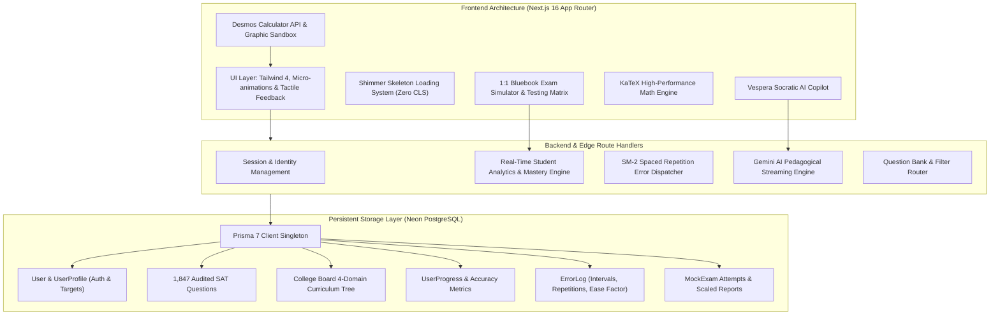

# 🌌 VESPERA SAT
### Autonomous Digital SAT 1600 Mastery Platform

**The Next-Generation Intelligent Training Ground for Digital SAT Perfection.**  
*Engineered for ambitious candidates targeting 1550+ scores through first-principles cognitive architecture.*

---

---

## 🏛️ Executive Overview & Pedagogy

**Vespera SAT** is an enterprise-grade Digital SAT learning platform designed to take students from foundational comprehension to an infallible **1600 score**.

Rather than relying on passive memorization or generic multiple-choice banks, Vespera applies modern cognitive neuroscience and first-principles pedagogy:

1. **Multimodal Triple-Layer Explanation Architecture:**
   * **Layer 1: Real-World Intuitive Analogy** — Demystifying complex mathematical concepts into concrete balance-scale, rate, and spatial intuition.
   * **Layer 2: Formal College Board Proof** — Rigorous mathematical derivations with complete $\KaTeX$ typesetting.
   * **Layer 3: 10-Second Desmos Regression Hack** — Rapid test-taking bypasses utilizing nonlinear regression (`~`), constant sliders, and intersection tracing.
2. **SuperMemo-2 (SM-2) Spaced Repetition Engine:**
   * Automated memory retention modeling counteracting the Ebbinghaus forgetting curve with adaptive review intervals (1 day, 3 days, 7 days, 16 days) based on recall difficulty.
3. **1:1 Official Bluebook Exam Simulation:**
   * Pixel-perfect replica of the College Board Bluebook testing environment, featuring 2-stage adaptive modules, strikethrough, annotations, question review grids, and scaled 400–1600 scoring.

---

## 🏗️ System Architecture

---

## 💎 Core Product Systems

### 1. 🎯 Authentic Question Vault (1,847 Items)
A curated, 100% verified question bank aligned with College Board Digital SAT specifications:
* **Reading & Writing (1,264 Questions):**
  * *Craft and Structure* (439 Qs) — Words in Context, Text Structure & Purpose, Cross-Text Connections.
  * *Information and Ideas* (329 Qs) — Central Ideas, Inferences, Command of Evidence.
  * *Standard English Conventions* (269 Qs) — Boundaries, Semicolon elimination rules, Form and Structure.
  * *Expression of Ideas* (227 Qs) — Rhetorical Synthesis, Transition logic.
* **Math (583 Questions):**
  * *Advanced Math* (175 Qs) — Quadratics, nonlinear systems, polynomial division, exponential growth.
  * *Algebra* (175 Qs) — Linear equations, inequalities, systems of two variables.
  * *Geometry & Trigonometry* (145 Qs) — Similar triangles, circle equations, trigonometry co-function identities.
  * *Problem-Solving & Data Analysis* (88 Qs) — Rates, proportions, margin of error, data distributions.
* **119 Student-Produced Response (Grid-in) Items:** Exactly 20.4% of math questions are numeric free-response, adhering to the official SAT blueprint.
* **Vector SVG Figures:** Every geometric, coordinate plane, and algebraic question contains responsive, dark-mode-ready SVG diagrams.

---

### 2. 🧪 1:1 Bluebook Digital SAT Simulator
* **Module Progression:** 2-stage adaptive difficulty modeling (Module 1 Baseline $\rightarrow$ Module 2 Hard/Easy Router).
* **Exam Controls:** Pinned countdown timer with 5-minute warning alert, question flag/review matrix, choice strikethrough tool, and formula reference sheet modal.
* **Score Report & Diagnostics:** Instant scaled 400–1600 calculation with domain accuracy radar charts and weakness diagnostics.

---

### 3. 🧠 SuperMemo-2 (SM-2) Spaced Repetition Queue
* Whenever a candidate misses a question, it automatically enters the **Error Log Vault**.
* The platform computes memory decay based on SM-2 parameters:
  $$\text{Interval}_{n} = \text{Interval}_{n-1} \times \text{EaseFactor}$$
* Students are scheduled for reviews at 24 hours, 72 hours, and 7-day intervals until mastery is proven.

---

### 4. ⚡ Official Desmos Engine & Sandbox
* Integrated Desmos Graphing API embedded side-by-side with practice questions.
* Pre-configured SAT presets:
  * Regression curve fitting ($y_1 \sim mx_1 + b$, $y_1 \sim a(x_1 - h)^2 + k$).
  * Constant slider intersections for linear/quadratic systems.
  * Rapid circle radius and center identification ($x^2 + y^2 + Ax + By + C = 0$).

---

### 5. 🤖 Socratic AI Pedagogical Mentor
* Powered by Google Gemini with custom SAT prompt engineering.
* Never simply reveals answers; guides students through targeted questions, hints, and first-principles intuition.
* Explains tricky answer choices, breaks down trap distractors, and suggests real-world analogies.

---

### 6. 📚 Khan Academy 13-Unit Curriculum & SATashkent Archive
* **13 Interactive Units:** Comprehensive chapter readings, interactive diagrams, and unit quizzes covering the entire Digital SAT Math & Verbal syllabus.
* **61 Physical Volumes (7,000+ Pages):** Direct integration with the curated SATashkent physical PDF archive.

---

### 7. 💫 Shimmer Skeleton Loading & Micro-Animations
* **Zero Cumulative Layout Shift (CLS):** Pure shimmer skeleton components across all pages replacing raw loading text.
* **Tactile Physics:** Micro-interactions on buttons, option selection pop-ins, and interactive hover cards.

---

## 🛠️ Technical Stack

| Domain | Technology | Purpose |
| :--- | :--- | :--- |
| **Framework** | [Next.js 16](https://nextjs.org) (Turbopack, App Router) | Server-side rendering, SSG, and edge route handlers |
| **Language** | [TypeScript 5](https://www.typescriptlang.org) | End-to-end type safety across client and server |
| **Database** | [PostgreSQL via Neon](https://neon.tech) | Serverless relational storage with connection pooling |
| **ORM** | [Prisma 7](https://prisma.io) | Schema management, migrations, and typed query client |
| **Styling** | [Tailwind CSS 4](https://tailwindcss.com) | Utility-first responsive design with CSS variables |
| **Typography & Math** | [KaTeX](https://katex.org) | Fast client-side mathematical typesetting |
| **Graphing Engine** | [Desmos Graphing API](https://www.desmos.com) | Integrated graphing calculator and regression simulator |
| **AI Core** | [Google Gemini](https://ai.google.dev) | Socratic tutor and exam copilot streaming |
| **Icons** | [Lucide React](https://lucide.dev) | Clean, consistent interface iconography |

---

## ⚙️ Configuration & Development

For developer setup, local environment variables, Prisma migration commands, and build scripts, please refer to:

👉 **[SETUP.md](./SETUP.md)**

---

**Vespera SAT** — Built with precision for the pursuit of perfection.  
*All test names and trademarks are the property of their respective owners (College Board).*

